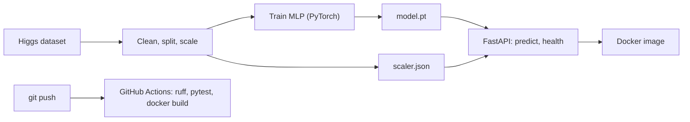

# Higgs Boson Classifier: PyTorch, FastAPI, Docker, CI


A binary classifier that separates Higgs-boson signal events from background in simulated
LHC collisions, packaged as a tested, containerized REST API with continuous integration.

## Results

Evaluated on a held-out test set that was never used for training or early stopping.

| Dataset | Rows | Test AUC | Test accuracy |
|---|---|---|---|
| Higgs, small OpenML version (id 23512) | ~98k | 0.803 ± 0.002 (5 seeds) | 72.7% |
| **Higgs, full dataset (id 42769)** | **786667** | **0.842** (single run) | **76.6%** |

- 28 features: 21 low-level kinematic and 7 high-level derived. Source: Baldi, Sadowski and
  Whiteson, 2014 (UCI / OpenML).
- Training on the larger dataset improved AUC by about 0.04. On the smaller one, changing the
  architecture (wider layers, BatchNorm, LR schedule) made no measurable difference.

## Architecture



The scaler statistics are stored as plain JSON, so the API needs only PyTorch and FastAPI
at serve time: no pickle files and no scikit-learn.

## Quickstart

```bash
docker build -t higgs-api .
docker run --rm -p 8000:8000 higgs-api
```

Open http://localhost:8000/docs to try `POST /predict` in the browser. It takes the 28
features in the order listed in `artifacts/scaler.json` and returns:

```json
{"label": "signal", "probability": 0.87}
```

`GET /health` is used by the Docker healthcheck.

## Development

```bash
python -m venv venv && venv\Scripts\activate
pip install -r requirements.txt
pip install -e .
python -m pytest -v          # unit tests
ruff check . && ruff format --check .
python -m higgs.train        # retrain
```

Training needs the Higgs dataset (OpenML id 42769) saved as `data/Higgs.arff`. It is not in
the repo because of its size. The Docker image does not need it: `model.pt` and
`scaler.json` are committed.

## Project layout

```
src/higgs/     data.py, model.py, train.py, serve.py
tests/         scaler, model I/O and API tests
scripts/       check_api.py, make_samples.py
data/          place Higgs.arff here (git-ignored)
artifacts/     model.pt, scaler.json, metrics
Dockerfile     CPU-only serving image
.github/       CI workflow
```

## Design notes and next steps

- The image uses a CPU-only PyTorch build, which keeps it much smaller than a GPU base image.
- Inputs with the wrong length, NaN or infinity are rejected with HTTP 422.
- Next: add baselines (logistic regression, gradient boosting) for comparison, try a deeper
  network with residual connections, and log experiments with MLflow.